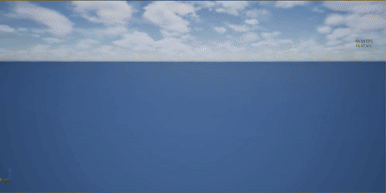

# TerrainManagerActor

An infinite, streaming, procedural terrain generator for **Unreal Engine 5**, implemented as a single actor (`ATerrainManagerActor`). Chunks are generated on worker threads around the player camera, meshed with LOD and edge stitching, and recycled as the player moves. Shape and surface texture are driven by layered noise and a temperature/moisture biome system.

## Demo
 <br>
▶ [Watch the demo on YouTube](https://www.youtube.com/watch?v=yV4OK1245CI)

## Features

- **Infinite streaming**: circular chunk footprint centered on the camera, with stale requests dropped as you move
- **Multithreaded**: noise sampling and mesh building run on the thread pool; the game thread only uploads a few meshes per frame
- **Crack-free LOD**: height depends only on world XY, and coarser-neighbor edges are stitched to match exactly
- **Layered terrain**: continents, masked ridged mountain ranges, hills, detail, all under a domain warp
- **Smooth biomes**: 8 default biomes blended by climate distance, with no hard seams
- **Material-ready**: vertex color carries four normalized surface-layer weights
- **Gameplay queries**: thread-safe `GetHeight`, `GetSurfaceLayerWeights`, `GetBiomeAt`
- **Pooled components** and collision cooked only on nearby chunks

## Requirements

- Unreal Engine **5.4+**
- [FastNoiseGenerator](https://www.fab.com/listings/c1d444fc-54cc-4f11-8a4a-c0c41112a321?lang=en) plugin (provides `UFastNoiseWrapper`)

## Setup

1. Install **FastNoiseGenerator** from Fab and enable it under **Edit → Plugins**.
2. Add the module dependencies in your `*.Build.cs`:

   ```csharp
   PublicDependencyModuleNames.AddRange(new string[]
   {
       "Core", "CoreUObject", "Engine",
       "FastNoiseGenerator", "FastNoise",
       "GeometryCore", "GeometryFramework", "DynamicMesh"
   });
   ```

3. In `TerrainManagerActor.h`, replace `PROJECTNAME_API` with your project's module API macro (e.g. `MYGAME_API`).
4. Compile.

## Usage

1. Right-click `ATerrainManagerActor` in the editor and create a child Blueprint class.
2. Place the Blueprint in your level at `0, 0, 0`.
3. Assign `TerrainMaterial` and adjust parameters as needed.
4. Press Play. Terrain streams in around the player camera (falling back to the pawn, then the actor).

Call `Regenerate(NewSeed)` to wipe and rebuild at runtime. Pass `0` to keep the current seed. A `Seed` of `0` randomizes on `BeginPlay`.

## Materials

Vertex color is **not a tint**. It carries four normalized weights (summing to 1) for a 4-layer material:

| Channel | Layer |
|---------|-------|
| R | Grass / verdant ground cover |
| G | Sand / dry dirt |
| B | Rock / gravel |
| A | Snow |

Rock-on-slope and snow-at-altitude are deliberately **not** baked in. Do them per-pixel in the material for sharper results:

- **Slope**: `VertexNormalWS.B`
- **Height**: `AbsoluteWorldPosition.B`

The mesh also provides UVs tiled every `UVTileSize` cm. Read the weights with a Vertex Color node as raw data. The component is set to `NoTransform` for vertex color space so weights aren't gamma-shifted.

## Parameters

| Category | Key properties |
|----------|----------------|
| **Terrain** | `Seed`, `ChunkSize` (cm), `VerticesPerChunk` (power of two), `TerrainMaterial`, `UVTileSize`, `HeightRemapCurve` |
| **Streaming** | `ChunkLoadRadius`, `LODRingDistances`, `MaxLOD`, `CollisionMaxLOD`, `ShadowMaxLOD`, `MaxConcurrentJobs`, `MaxChunkUploadsPerFrame`, `SkirtDepth` |
| **Shape** | Frequency and amplitude for continent, mountain, hill, and detail noise; `MountainRangeThreshold`; `WarpStrength` / `WarpFrequency` |
| **Biomes** | `Biomes` array, `Temperature/MoistureFrequency`, `BiomeBlendSharpness`, `BiomeContrast`, `ClimateContrast` |

Each `FTerrainBiome` defines a climate point (temperature, moisture) plus base height, mountain/hill/detail multipliers, and primary/secondary surface layers.

**Performance tips:** if you see hitches, lower `MaxChunkUploadsPerFrame`. If chunks load slowly, raise `MaxConcurrentJobs`. Collision is only cooked up to `CollisionMaxLOD`, so keep it small.

## API

| Function | Description |
|----------|-------------|
| `GetHeight(X, Y)` | Full-detail terrain height at a world position |
| `GetSurfaceLayerWeights(X, Y)` | RGBA layer weights, same order as the material |
| `GetBiomeAt(X, Y)` | Name of the dominant biome |
| `Regenerate(Seed)` | Rebuild all chunks |
| `LogBiomeCoverage(Samples, Extent)` | Editor-callable diagnostic: logs how much area each biome covers |

All query functions are thread-safe. Footsteps, decals, and foliage scatter can ask the terrain what it's made of at any point.

## How it works

1. **Streaming**: each time the camera crosses a chunk boundary, the desired chunk set and each chunk's LOD are recomputed. Missing or outdated chunks are queued nearest-first.
2. **Generation**: up to `MaxConcurrentJobs` thread-pool jobs sample `SampleTerrain` over a grid (with a one-cell border for normals) and build a `FDynamicMesh3` with normals, UVs, and vertex colors.
3. **Terrain function**: a pure function of world XY. It applies domain warp, then samples continent, climate, mountain range mask, ridged mountains, hills, and detail noise, with biome parameters blended in. Because it has no LOD term, neighbors always agree on shared vertices.
4. **Biome blending**: the four strongest biomes by climate distance are kept, the fourth's weight is subtracted as a floor, and the rest are normalized. This gives each biome compact influence with no pop.
5. **LOD stitching**: each chunk knows its neighbors' LODs. Edge vertices facing a coarser neighbor are snapped onto the neighbor's straight segment, and a small skirt covers any float error.
6. **Upload**: finished meshes are budgeted per frame, discarded or requeued if the player moved on, then applied to pooled `UDynamicMeshComponent`s.

## Notes

- Single-player only (no replication).
- Heights are in cm and depend only on world XY plus seed, so results are deterministic.
- Chunk meshes use local-space vertices to avoid precision loss far from the origin.
